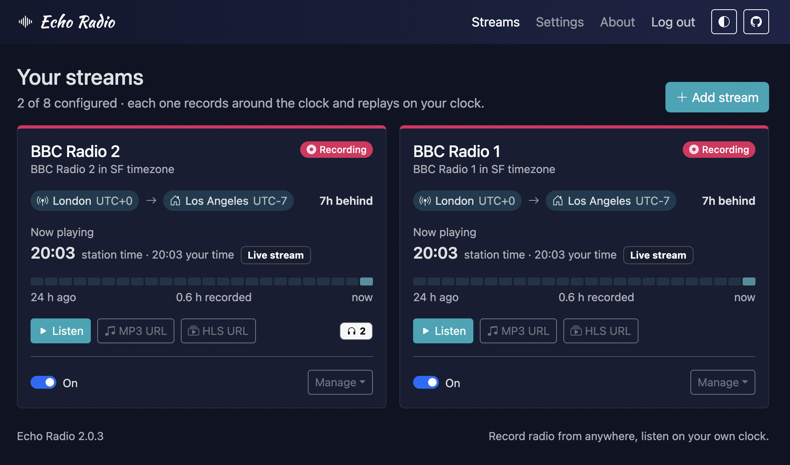

# EchoRadio

## Listen to international radio in your local timezone

Wish you could wake up to your favourite New York breakfast show, or fall asleep to Australian
talk radio, at the times those shows are *meant* to be heard? EchoRadio records internet radio
stations around the clock and replays them shifted into your timezone, so the 7 am show plays at
your 7 am.



## Features

- **Exact time shift.** Pick the station's timezone and yours. Half-hour zones and daylight-saving
  changes on either side are handled automatically; the shift is recomputed continuously.
- **Web player with rewind.** Scrub back through the recent buffer, jump to the start of the show
  or hour, mark moments to come back to, speed up talk radio, watch a spectrum analyser, send it to
  AirPlay or a Chromecast, control playback from your lock screen or headphones, set a sleep timer,
  install it as an app.
- **Programme guide.** BBC stations get their schedule automatically; other stations can have a
  weekly schedule typed in. The current show is named in the player, on the cards and in the
  Icecast stream title.
- **Plain MP3 streams too.** Every station has a `http://…/listen/<name>` URL for Sonos, car apps,
  VLC and anything else that plays internet radio, plus an HLS URL.
- **Fallback audio.** While the buffer fills, or if the station goes offline, listeners hear bird
  song, a voice message, silence or the live station instead of dead air.
- **One container, one port.** nginx, Icecast, liquidsoap and a small Flask app in a single image
  for amd64 and arm64. Optional admin password, automatic configuration backups, disk guardrails,
  source health history, health check.

## Quick start

```yaml
# docker-compose.yaml
services:
  echoradio:
    image: simonsecuritypedant/echoradio:latest
    container_name: echoradio
    ports:
      - "8080:8080"   # web UI, player, HLS and /listen/<stream>
      - "8000:8000"   # optional: direct Icecast access
    volumes:
      - echoradio_data:/app/data
    restart: unless-stopped
volumes:
  echoradio_data:
```

```sh
docker compose up -d
```

1. Open `http://<host>:8080`. The first visit shows the setup page: choose the Icecast passwords and,
   optionally, an admin password so you can share the address with listeners without letting them
   change anything.
2. Click **Add stream**, paste a stream URL (MP3, AAC or an HLS `.m3u8`; anything VLC plays usually
   works), search for the station's timezone and your own, and save. The form shows the resulting
   delay before you commit.
3. Press **Listen**. Until the buffer has filled (the length of the delay) you will hear the fallback
   audio you chose; after that, the station as it sounded at this time of day where it broadcasts.

Keep the data volume: it holds your settings, stream definitions and the rolling recordings
(about 57 MB per hour per station at the default 128 kbit/s, 30 hours kept by default). A bind
mount (`- /srv/echoradio:/app/data`) works too; the container fixes the directory's ownership on
start and then runs as an unprivileged user. If you run it with `user:` set, make the directory
writable by that uid yourself.

### Exposing it on the Internet

The UI and all audio share port 8080, so a single [Cloudflare Tunnel](https://developers.cloudflare.com/cloudflare-one/connections/connect-networks/)
hostname pointing at `http://echoradio:8080` is all you need. Because the player uses the same origin
as the page, it works over HTTPS without any extra configuration. Turn on the admin password in
Settings first.

### Settings

| Setting | Meaning |
|---|---|
| Require admin password | Management pages and actions need a login; listening stays open. |
| Icecast passwords | Used internally; also protect Icecast's own admin pages on port 8000. |
| Maximum streams | Number of stations you can add. |
| Keep recordings for | Rolling buffer length in hours (25–168). |
| Rewind window | How far back the web player can scrub (1–24 h). |
| Public address | Optional base URL used for the copyable stream links. |

Settings also shows disk usage with the projected size at the current retention, keeps the last 30
automatic configuration backups (one is written on every change) with one-click restore, and trims
recordings automatically if free space drops below 2 GB or 5 % of the volume.

Per stream you can also choose a **recording mode**: the default re-encodes to AAC at the chosen
quality; "copy" records the source's AAC packets as-is (less CPU, no generation loss, but only for
AAC sources) and a **programme guide** source (BBC automatic, or a weekly schedule you enter).

Environment variables: `SECRET_KEY` (Flask session key; generated and persisted if unset),
`PUBLIC_BASE_URL`, `ECHORADIO_MIN_DELAY_SECONDS` (default 120), `ECHORADIO_RELAY_LEAD_SECONDS`
(default 35, alignment of the MP3 relay), `ECHORADIO_AUTOSTART=0` to not start streams at boot.

## How it works

```
station ──▶ liquidsoap (input.http) ──▶ 10 s AAC/MPEG-TS segments on disk
                                             │
                      Flask builds time-shifted playlists ◀──┘
                      ├── /hls/<stream>/live.m3u8   (sliding window)   ─▶ hls.js / Safari
                      ├── /hls/<stream>/dvr.m3u8    (rewind window)    ─▶ web player
                      └── /hls/<stream>/relay.m3u8  ─▶ liquidsoap ─▶ Icecast ─▶ /listen/<stream> (MP3)
```

For a listener whose wall clock reads *W* in their timezone, EchoRadio finds the instant the
station's wall clock read *W* and serves the segments recorded then. Missing segments are replaced by
fallback segments encoded with the same codec parameters, spliced with HLS discontinuity tags, so
players never stall. nginx serves segments straight from disk; Flask only generates playlists.

## Upgrading from 1.x

Start the 2.x image on the same data directory. Settings and streams are kept; the Icecast public
hostname/protocol/port settings are replaced by the optional public address. v1 hourly recordings
are converted to the new segment layout where possible. If you ran 1.x without a volume, export the
configuration from the old Settings page first and import it in 2.x.

## Development

Requirements: Docker, Python 3.13 (for the unit tests), optionally `ffprobe`.

```sh
# Build and run with the source tree mounted (edits apply on `supervisorctl restart web`)
docker compose -f docker-compose-dev.yaml up -d --build
docker compose -f docker-compose-dev.yaml logs -f

# Unit tests (timeline / delay maths, pure standard library)
python3 -m venv .venv && .venv/bin/pip install -r python/requirements.txt -r python/requirements-dev.txt
.venv/bin/python -m pytest python/tests

# Useful while developing
docker exec echoradio supervisorctl status
docker exec echoradio liquidsoap --check /app/data/streams/<stream>/stream.liq
curl http://localhost:8080/hls/<stream>/live.m3u8
ffmpeg -i http://localhost:8080/hls/<stream>/live.m3u8 -t 20 -f null -
```

The dev compose file sets `ECHORADIO_MIN_DELAY_SECONDS=120`; pairing a station timezone with one
15 minutes away (for example `Asia/Kathmandu` → `Asia/Kolkata`) lets you watch fallback audio hand
over to recorded audio within minutes.

### Publishing a multi-arch image

Pushing a version tag (for example `2.1.0`) runs the GitHub Actions workflow in
`.github/workflows/docker.yml`, which builds the amd64 and arm64 image, pushes it to Docker Hub as that
version and `latest`, and creates the GitHub release from the matching `CHANGELOG.md` section. The
repository needs two secrets: `DOCKERHUB_USERNAME` and `DOCKERHUB_TOKEN` (a Docker Hub access token).

To build by hand instead:

```sh
docker buildx build --platform linux/amd64,linux/arm64 -t simonsecuritypedant/echoradio:latest --push .
```

Liquidsoap comes from Savonet's prebuilt `.deb` (`LIQUIDSOAP_VERSION` build argument, default 2.4.6),
so the build takes about a minute per architecture.

## Why not host it on Cloudflare?

It was evaluated. Cloudflare Containers can run this image but give no uptime guarantee, wipe local
disk on restart and cost more than a small VPS; pure Workers cannot hold a connection to a station
for more than 15 minutes, so a serverless recorder would have to reconnect constantly; Cloudflare
Stream only accepts pushed video. Self-hosting behind a free Cloudflare Tunnel remains the right fit.

## License

MIT License

## Credits

Built by [Simon Thorpe](https://github.com/securitypedant). Inspired by the power of community broadcasting.
